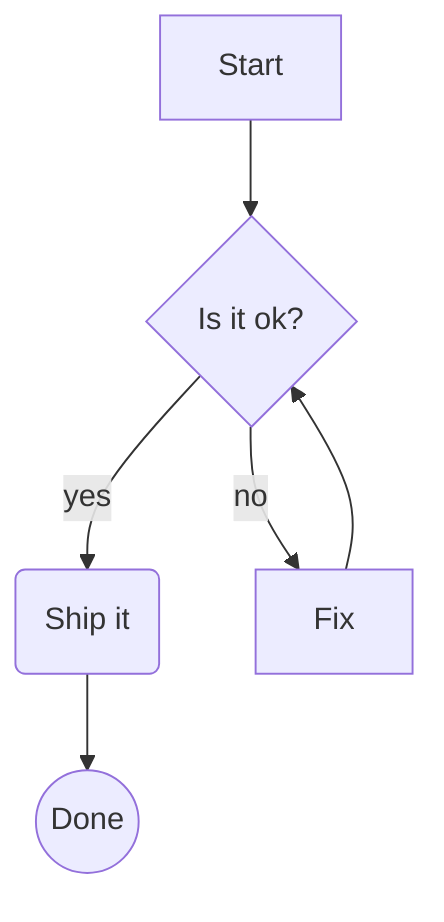
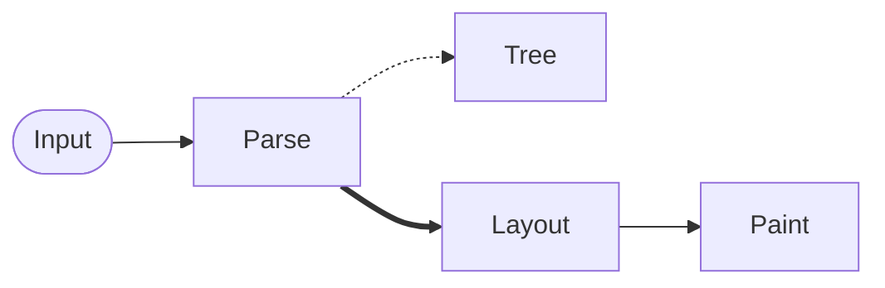
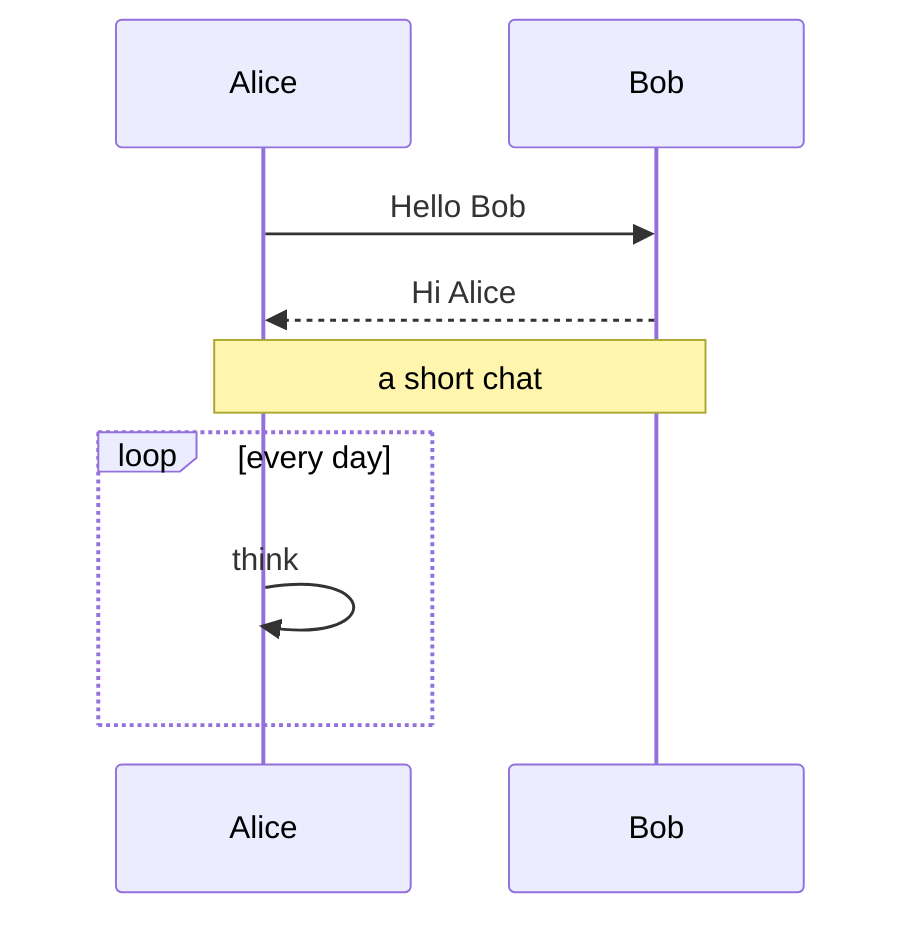
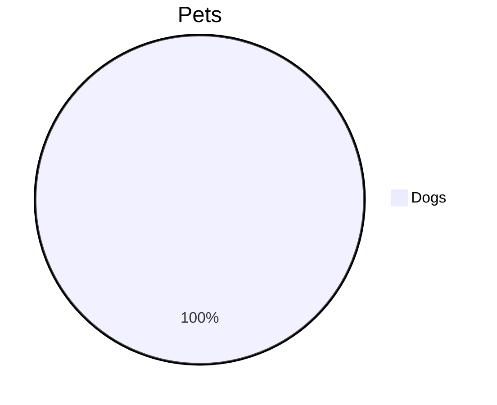

# Rich blocks

Code with highlighting:

```rust
use std::collections::HashMap;

/// A tiny cache.
fn fib(n: u64) -> u64 {
    if n < 2 { return n; } // base case
    let name = "fib";
    fib(n - 1) + fib(n - 2)
}
```

```python
def greet(name: str) -> str:
    """Say hi."""
    return f"hi {name}" if name else None  # fallback
```

```json
{"name": "rustsidian", "tags": ["a", "b"], "n": 3.5, "ok": true}
```

```diff
@@ -1,2 +1,2 @@
-old line
+new line
```

## Math

Euler wrote $e^{i\pi} + 1 = 0$ and $\alpha_1 \leq \sqrt{x^2+y^2}$ inline.

$$
\int_0^\infty e^{-x^2}\,dx = \frac{\sqrt{\pi}}{2}
$$

$$
\sum_{n=1}^{\infty} \frac{1}{n^2} = \frac{\pi^2}{6}, \qquad \left( \frac{a+b}{c} \right)^2
$$

$$
A = \begin{pmatrix} a & b \\ c & d \end{pmatrix}, \quad \mathbf{v} \in \mathbb{R}^n, \quad \text{unknown: } \foo{x}
$$

$$
\begin{aligned} f(x) &= (x+1)^2 \\ &= x^2 + 2x + 1 \end{aligned}
$$

## Mermaid








