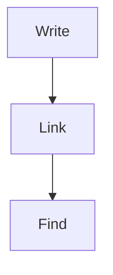

# Syntax Tour

## Inline

*Italic*, **bold**, ***both***, ~~struck~~, ==highlighted==, `inline code`, $e^{i\pi} + 1 = 0$, a footnote[^1], an inline footnote^[Right here.], a tag #demo/nested, %%a hidden comment%% and an [external link](https://example.org "Example").

Links: [[Welcome]], [[Welcome#Welcome to the demo vault|to a heading]], [[Projects/Garden#^plan]], [Markdown link](Projects/Garden.md), ![[Attachments/pixel.png|32]].

## Blocks

> A plain quote
> on two lines.

> [!warning]- Folded callout
> Hidden until expanded.

1. Ordered
2. List
   - Nested bullet
   - [ ] Nested task

| Feature | Status |
|:--------|-------:|
| Tables  |    yes |
| `\|` pipes | escaped |

```rust
fn main() {
    println!("code block");
}
```



$$
\int_0^1 x^2 \, dx = \tfrac{1}{3}
$$

---

This paragraph has a block id. ^tour-block

[^1]: The footnote text.
